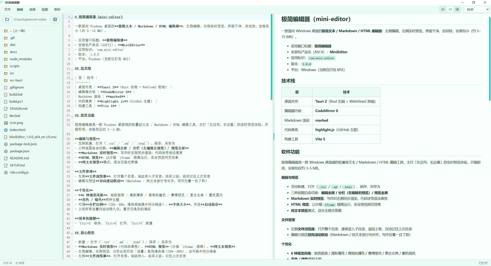

# 极简编辑器（mini-editor）

> **左边写，右边看。约 3.4 MB 的安装包，干好了写作这件事。**

一款面向 Windows 桌面的**极简文本 / Markdown / HTML 编辑器**：左侧编辑、右侧实时预览，界面干净、启动快、安装包小（约 3–5 MB）。

很多 Markdown 工具都号称「轻量」，装完却动辄上百兆、启动要等几秒。极简编辑器基于 **Tauri 2 + CodeMirror 6**，用 Rust 后端接系统 WebView2，不打包 Chromium、不需要账号、不联网，所有文件都在你自己的硬盘上。双击就开，打开即写。

**它能做什么：**
- **双栏实时预览**：左侧 CodeMirror 6 编辑，右侧同步渲染，按行号双向滚动联动
- **一个编辑器，四种内容**：Markdown（代码块高亮）/ HTML（沙箱 `iframe` 隔离）/ JSON、XML（自动格式化 + 高亮）/ 纯文本
- **像模像样的文件管理**：左侧文件浏览器 + 多页签 + 未保存圆点 + 前进/后退浏览历史
- **全局查找替换**：Chrome 风格顶部浮动条，自动在编辑器 / 预览区之间切换搜索目标
- **6 种视觉风格 × 亮暗双主题**：极致极简 / 清新薄荷 / 高饱和撞色 / 赛博朋克 / 复古古典 / 墨色国风
- **纯本地优先**：文件读写全在 Rust 侧完成，不经任何服务器

- 应用窗口标题：**极简编辑器**
- 安装包产品名（ASCII）：**MiniEditor**
- 应用标识：`com.mini.editor`
- 版本：`1.0.0`
- 平台：Windows（当前仅打包 MSI）

## 软件截图



> 左侧文件浏览器 + 中间编辑区 + 右侧实时预览，支持 Markdown / HTML / JSON / XML / 纯文本。

## 技术栈

| 层 | 技术 |
|---|---|
| 桌面外壳 | **Tauri 2**（Rust 后端 + WebView2 前端） |
| 编辑器内核 | **CodeMirror 6** |
| Markdown 渲染 | **marked** |
| 代码高亮 | **highlight.js**（GitHub 主题） |
| 构建工具 | **Vite 5** |

## 软件功能

极简编辑器是一款 Windows 桌面端的轻量级文本 / Markdown / HTML 编辑工具，主打「左边写、右边看」的实时预览体验，开箱即用、安装包仅约 3–5 MB。

**编辑与预览**
- 支持新建、打开（`.txt` / `.md` / `.html` / `.json` / `.xml`）、保存、另存为
- 三种视图自由切换：**编辑全屏 / 分栏（左编辑右预览）/ 预览全屏**
- **Markdown 实时预览**：写作时右侧同步渲染，代码块带语法高亮
- **HTML 预览**：以沙箱 `iframe` 隔离运行，安全预览网页效果
- **JSON / XML 预览**：自动格式化缩进并语法高亮，便于查看结构化数据
- **纯文本预览**模式，适合无格式草稿

**文件管理**
- 左侧**文件浏览器**：打开整个目录、逐级进入子目录、返回上级，自动记住上次目录
- 编辑与预览**双向滚动联动**（Markdown / 纯文本按行号对齐，写作位置一目了然）
- **多页签**：拖拽打开、右键菜单（关闭其他 / 左侧 / 右侧 / 全部）、在新窗口打开、重新加载；每个页签独立记住编辑区与预览区滚动位置
- **前进 / 后退**浏览历史，点击预览里的相对链接（如 `other.md`、`img.png`）可直接跳转或显示图片

**查找替换**
- Chrome 风格**顶部浮动查找条**（`Ctrl+F` 查找、`Ctrl+H` 替换、`F3` 跳下一个）
- 编辑视图搜编辑器、预览视图自动改搜渲染结果，预览重渲染后匹配自动失效重算

**个性化**
- **6 种视觉风格**：极致极简 / 清新薄荷 / 高饱和撞色 / 赛博朋克 / 复古古典 / 墨色国风；每种风格连字体族、圆角、阴影气质一起换
- **亮色 / 暗色**两种主题
- 可调**分栏比例**（20%–80%，滑块或拖拽中间分隔条）、**字体大小**、开启**自动保存**
- 上述所有设置均自动持久化，重开仍是你的偏好

**效率快捷键**
- `Ctrl+S` 保存、`Ctrl+O` 打开、`Ctrl+N` 新建、`Ctrl+F` 查找、`Ctrl+H` 替换、`Ctrl+/-/0` 字号缩放
- 状态栏实时显示字符数与保存状态

## 核心特性

- 新建 / 打开（`.txt` / `.md` / `.html` / `.json` / `.xml`）/ 保存 / 另存为
- **Markdown 实时预览**（代码块高亮）、**HTML 预览**（沙箱 `iframe` 隔离）、**JSON / XML 预览**（自动格式化 + 高亮）、**纯文本预览**
- 左侧编辑、右侧预览，分栏比例可在「设置」里用滑块调（20%–80%），也可拖中间分隔条
- 左侧**文件浏览器**：打开目录、逐级进入、返回上级、记住上次目录
- 编辑与预览**双向滚动联动**（Markdown / 纯文本按行号对齐；HTML 模式不参与）
- 三种视图：编辑全屏 / 分栏 / 预览全屏，一键切换
- 设置项：**分栏比例、6 种视觉风格（极致极简/清新薄荷/高饱和撞色/赛博朋克/复古古典/墨色国风）+ 亮/暗模式、字体大小、自动保存**；均持久化
- 快捷键：`Ctrl+S` 保存、`Ctrl+O` 打开、`Ctrl+N` 新建

## 目录结构

```
mini-editor/
├── index.html              # 入口
├── src/                    # 前端（编辑器 / 预览 / 分栏 / 文件树 / 设置）
│   ├── main.js             # 应用装配、菜单、视图切换
│   ├── editor.js           # CodeMirror 6 封装
│   ├── preview.js          # Markdown / HTML / 文本渲染
│   ├── split.js            # 分栏拖拽
│   ├── explorer.js         # 文件浏览器
│   ├── scrollsync.js       # 编辑/预览滚动联动
│   ├── settings.js         # 设置持久化（localStorage）
│   ├── files.js            # 文件读写（Tauri invoke + 浏览器退化方案）
│   └── style.css           # 全部视觉样式（含浅/深主题变量）
├── src-tauri/              # Rust 后端
│   ├── Cargo.toml
│   ├── build.rs
│   ├── tauri.conf.json     # 窗口/打包配置（仅打 msi）
│   ├── capabilities/default.json
│   ├── src/main.rs         # 文件打开/保存/读写命令
│   └── icons/              # 图标（由 scripts/gen-icons.mjs 生成）
├── scripts/
│   ├── gen-icons.mjs       # 纯 Node 生成图标脚本
│   └── copy-msi.mjs        # 打包后复制 msi 到根目录
├── build.bat / build.ps1   # 一键打包脚本
├── dev.bat                 # 开发启动
└── vite.config.js
```

## 快速开始

```powershell
npm install          # 安装前端依赖
npm run icons        # 生成 src-tauri/icons/ 下的图标（首次必须）
npm run tauri dev    # 开发预览（热重载）
```

> 环境安装、打包 MSI、常见坑等所有操作步骤，请见 **[SETUP.md](./SETUP.md)**。

## 打包发行

```powershell
.\build.bat          # 等价于 npm install + tauri build --bundles msi + 复制 msi
```

产物：`MiniEditor_1.0.0_x64_en-US.msi`（落在项目根目录，原始产物在 `src-tauri/target/release/bundle/msi/`）。

## 设计资源

- 界面风格、配色、布局与图标规范，见 **[DESIGN.md](./DESIGN.md)**（供 UI / 图标设计参考）。

## 下载

- **Gitee Releases（推荐）**：<https://gitee.com/lukeffie/mini-editor/releases>
  在 Releases 页面下载 `MiniEditor_x64_en-US.msi`，双击按提示安装即可。
- **GitHub 仓库**：<https://github.com/Lukeffie/mini-editor.git>
- **本地发行包**：仓库根目录已附带 `MiniEditor_1.0.0_x64_en-US.msi`（约 3.4 MB），可直接使用。

> 系统要求：Windows 10/11 64 位，安装时会按需下载 WebView2 运行时（若系统尚未安装）。
> 当前仅提供 x64 的 MSI 安装包。

如需自行打包最新版本：

```powershell
.\build.bat          # 生成最新的 MiniEditor_*.msi 到项目根目录
```

## 我的作品宣言

这个 1024，我做了一个**只有 3.4 MB 的 Windows 桌面编辑器**，让**想写字、写代码、写文档的人，从双击图标到落笔，不超过一秒**。

我们已经有 VS Code、Typora、Notion——但它们都太重了。为了改一个 README，要付出几秒启动、几百兆磁盘，和一堆用不上的功能包围。我想要的编辑器只有一件事：**点开，然后写。**

于是有了 MiniEditor：Tauri 2 接系统 WebView2，CodeMirror 6 作编辑内核，不打包 Chromium，不绑定账号。安装包 3.4 MB，冷启动几乎无感，文件全程留在你自己的硬盘上。

**我坚持的三件事：**

**一、轻，是一种态度。** 不是营销话术，是每一次打开都不用等。

**二、写和看，应该同时发生。** 左边写，右边同步渲染；滚到哪，预览跟到哪。不用切换去确认渲染对不对。

**三、工具应该适应人，而不是相反。** 六种风格，每种连字体、圆角、阴影一起换；分栏比例、字号、主题、上次目录全部记住。它打开的瞬间，就是你的样子。

> **左边写，右边看；三兆大小，一秒落笔。**

把复杂留给实现，把简单留给你。
